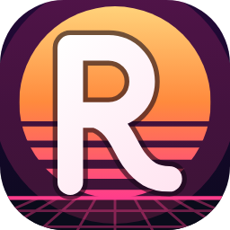

<p align="center"></p>

# Rodwave

**A Sanny Builder for mobile.** Rodwave is an open-source script studio for *GTA: San Andreas* on Android:
write CLEO scripts on your phone or tablet, compile them to `.csa`/`.csi`, decompile existing scripts,
check what your game setup supports, and install mods with a dry run and backups.

Version 0.1.0 · Kotlin, Jetpack Compose, Material 3 · Android 8.0+ (API 26) · offline · no root · MIT

> **Status.** The scripting engine (compiler, decompiler, analysis, mod installer) has 92 automated tests
> that pass. The Android app is complete in code, but it has **not yet been built into an APK or run on a
> device**, because the environment it was written in cannot reach Google's Maven repository. Its UI code
> is type-checked against Compose, and its Android code against the Android 15 framework.
> See [docs/STATUS.md](docs/STATUS.md) for exactly what is verified and what is not.

## What it does

| Area | Highlights |
| --- | --- |
| **Editor** | Tabs, syntax highlighting, line numbers, current-line and bracket highlight, auto-indent, find/replace with regex, undo/redo, autocomplete from the opcode library, Sanny-style command help in the status bar, live diagnostics, outline, go to line, snippets, formatter, symbol bar for on-screen keyboards, autosave and crash recovery |
| **Compiler** | Sanny Builder–compatible syntax for CLEO Android: `if`/`then`/`else`, `while`, `repeat`/`until`, `for`, `break`/`continue`, `const`, typed variables, arrays, strings, models, enums, `{$INCLUDE}`. Every output is decoded back and checked before it is reported as compiled |
| **Decompiler** | Control-flow guided disassembly of `.csa`/`.csi`/`.cs`; the listing is recompiled and compared byte for byte; read-only main.scm header and listing |
| **Script inspector** | Verdict (ready, needs review, PC script), PC CLEO opcode collisions, CLEO Android commands, touch/menu/memory use, hex view, opcode histogram |
| **Compatibility Center** | Six evidence-based states for the game, CLEO Android, the CLEO library for AML, AML, native mods, `.fxt`, PC scripts and more. File names alone never count as verification. Exportable report |
| **Game Directory** | Choose, change and forget folders through the system picker; explains Android 11+ storage limits; scans folders read-only |
| **Mod Manager** | Import `.csa`/`.csi`/`.fxt`/`.so`/`.ini`/`.zip` (path traversal rejected); dry-run plan; conflict and ownership detection; backups of replaced files; verified writes with rollback; history and restore |
| **Opcode Explorer** | Search commands and enums; download or import the Sanny Builder Library on request |
| **Tools** | Binary viewer (ELF/ZIP/script by content), diff, dependency analysis, batch compile, templates and snippets, workspace backup and restore, operation console, offline docs |

## Build

Requirements: JDK 17 or newer, Android SDK with platform 35, and internet access to Google's Maven
repository and Maven Central (Android Studio Ladybug or newer works).

```bash
./gradlew :app:assembleDebug          # APK: app/build/outputs/apk/debug/app-debug.apk
./gradlew :engine:test                # engine tests, no Android SDK needed
./gradlew :desktop:compileKotlin      # type-checks the shared UI without the Android SDK
./gradlew :desktop:run                # desktop preview window (needs Google's Maven for AndroidX runtime jars)
./gradlew :desktop:run --args="screenshots out"   # renders every screen to out/*.png
```

On a machine without the Android SDK, add `-Prodwave.includeAndroid=false` to build only the engine and
the desktop harness.

Optional maintainer check: verify the built-in opcode table against the Sanny Builder Library with
`RODWAVE_SBL_JSON=/path/to/sa_mobile.json ./gradlew :engine:test`.

Install the debug APK with `adb install app/build/outputs/apk/debug/app-debug.apk` or by copying it to the
device.

## First steps on the device

1. **Opcode library (optional).** The built-in set covers control flow, maths, common commands, mobile
   widgets and the CLEO Android extension. For all ~2,700 SA Mobile commands, open *Opcode Explorer* and
   download the Sanny Builder Library (you confirm first), or import `sa_mobile.json` yourself.
2. **Folders.** In *Game Directory*, pick the folders you can reach: your CLEO scripts folder, the AML mods
   folder (`AMLMods/com.rockstargames.gtasa`) and an export folder. On Android 11+ the system picker cannot
   open `Android/data`; Rodwave explains the alternatives instead of pretending otherwise.
3. **Write.** Create a project from a template (touch toggle, menu script, vehicle spawner, version check),
   edit `main.txt` and tap the compile button.
4. **Install.** From the compile dialog, save the file, copy it to the export folder, or add it to the Mod
   Manager, which shows a dry run and backs up anything it replaces.

Rodwave cannot run scripts, so behaviour in the game is always untested until you try it. Keep backups.

## Project layout

```
engine/    Plain Kotlin/JVM: bytecode model, opcode database, compiler, decompiler, analysis,
           compatibility rules, ELF inspection, safe ZIP, mod planner/installer, projects, editor logic
app/       Android app: core/ (state, settings, workspace), ui/ (Compose screens), android/ (SAF,
           package detection), MainActivity, resources and the vector launcher icon
desktop/   Compose Desktop harness that compiles app/core and app/ui without an Android SDK
samples/   Original sample scripts; every one is compiled and round-tripped by the test suite
docs/      Feature matrix, compatibility notes, script language, status, third-party notices
```

## Documentation

- [Feature matrix](docs/FEATURES.md)
- [Compatibility notes](docs/COMPATIBILITY.md): game versions, CLEO vs AML, states, Android storage
- [Script language](docs/SCRIPT_LANGUAGE.md): syntax and diagnostics
- [Status, verification and blockers](docs/STATUS.md)
- [Third-party notices](docs/THIRD_PARTY_NOTICES.md)
- [Sample scripts](samples/README.md)

## Principles

- Uses only Android's supported file-access APIs; requests no storage permission and never root.
- Never silently overwrites or deletes files: every change is planned, confirmed, backed up and verified.
- Never claims a compile succeeded unless the output passed validation, and never infers compatibility
  from file names alone.
- Keeps data on the device. The network is used only for downloads you request.
- Ships no Rockstar game files and no third-party opcode database; see the notices for attributions.

## Licence

MIT, see [LICENSE](LICENSE). Rodwave is not affiliated with Rockstar Games, Take-Two Interactive,
Sanny Builder, CLEO or AndroidModLoader.

The files `GAMEDUMP_V2_DELTA.txt` and `GAMEDUMPER_V3_DELTA.txt` predate Rodwave in this repository and are
not part of it.
